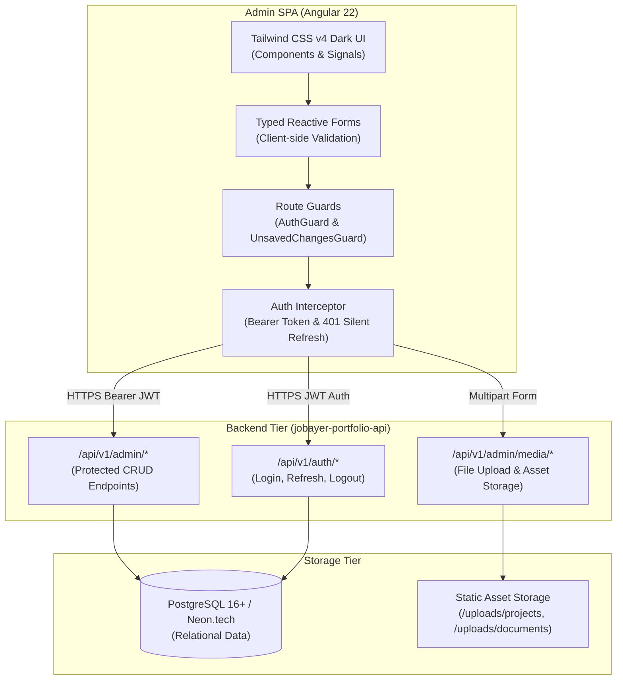

# Jobayer Portfolio Admin Dashboard (`jobayer-portfolio-admin`)

A modern, high-performance administrative Single Page Application (SPA) designed to manage all dynamic content, metadata, media assets, and incoming messages for the professional portfolio ecosystem.

Built with **Angular 22**, **TypeScript**, **Tailwind CSS v4**, and **RxJS**, adhering to enterprise design principles: standalone components, reactive signals, typed reactive forms, functional route guards, and silent token refresh via HTTP interceptors.

---

## 🏛 Architecture Overview

The admin dashboard acts as the private control plane for the portfolio system, interacting securely with the backend REST API:



---

## ✨ Core Features & Management Modules

The dashboard provides specialized, full-featured interfaces for every aspect of the portfolio:

| Module | Route | Capabilities |
| :--- | :--- | :--- |
| **📊 Telemetry Dashboard** | `/dashboard` | Real-time system overview, message counts, active projects counter, and unread notification alerts. |
| **👤 Profile & Bio** | `/profile` | Manage display name, headline, professional biography, working approach, and social profile links. |
| **🚀 Project Portfolio** | `/projects` | Full CRUD for case studies: Markdown-ready summaries, feature toggles, tech stack tags, live demo & GitHub links. |
| **💼 Career Experience** | `/experiences` | Chronological career history: organization, role, employment type, location, bulleted responsibilities, and "Current" badges. |
| **🎓 Education & Honors** | `/educations` | Degree programs, institutions, fields of study, start/end dates, GPAs, and academic achievements. |
| **🛠 Technical Skills** | `/skills` | Categorized capability management (Backend, Frontend, Cloud/DevOps, Architecture), proficiency ratings, and order index. |
| **📜 Certifications** | `/certifications` | Professional certificates, issuing bodies, issue/expiration dates, credential IDs, and verification URLs. |
| **📚 Research Publications** | `/publications` | Academic research papers, conference proceedings, peer-reviewed journals, publication dates, and DOIs. |
| **✉️ Inquiries & Messages** | `/messages` | Read-only contact message viewer with unread indicators, sender audit metadata, and quick reply links. |
| **📁 Media & Document Asset Manager** | `/media` | Drag-and-drop file upload for project screenshots and resumes, with instant preview and copy-to-clipboard public URLs. |

---

## 🔒 Security & UX Safeguards

1. **JWT Authentication & Silent Refresh**:
   - Access tokens are passed via standard `Authorization: Bearer <token>` headers.
   - When an access token expires (HTTP 401), `auth.interceptor.ts` intercepts the response, executes a silent refresh with the rotating refresh token, and replays the original failed request without interrupting the administrator.
2. **Functional Route Guards**:
   - `auth.guard.ts`: Enforces authentication, redirecting unauthenticated visitors to `/auth/login` with `returnUrl` preservation.
   - `unsaved-changes.guard.ts`: Detects dirty form state and alerts administrators before accidentally leaving a page with unsaved modifications.
3. **Destructive Action Safety**:
   - Deletions are guarded by the modal `ConfirmDialogComponent`, requiring explicit user confirmation before executing `DELETE` requests.
4. **Toast Feedback**:
   - Non-blocking notifications (`ToastService`) display real-time success confirmations and detailed server validation errors.

---

## 📂 Project Structure

```
jobayer-portfolio-admin/
├── src/
│   ├── app/
│   │   ├── core/
│   │   │   ├── auth/              # AuthService, AuthInterceptor, AuthGuard
│   │   │   ├── guards/            # UnsavedChangesGuard
│   │   │   ├── models/            # TypeScript interfaces matching backend DTOs
│   │   │   ├── services/          # ToastService, ConfirmDialogService
│   │   │   └── utils/             # Form error mapping & validation helpers
│   │   ├── features/
│   │   │   ├── auth/              # Login screen with validation & return URL
│   │   │   ├── dashboard/         # Metrics overview & quick action cards
│   │   │   ├── profile/           # Biography & social links editor
│   │   │   ├── projects/          # Project list & case study editor
│   │   │   ├── experiences/       # Career history timeline editor
│   │   │   ├── educations/        # Academic credentials manager
│   │   │   ├── skills/            # Capability matrix manager
│   │   │   ├── certifications/    # Professional licenses editor
│   │   │   ├── publications/      # Research papers & publications manager
│   │   │   ├── messages/          # Contact inbox & message reader
│   │   │   └── media/             # Image & document upload manager
│   │   ├── shared/
│   │   │   └── components/        # ConfirmDialogModal, reusable UI widgets
│   │   ├── app.component.ts       # Root layout with responsive sidebar & topnav
│   │   ├── app.config.ts          # Angular providers, router, HTTP interceptors
│   │   └── app.routes.ts          # Lazy-loaded route declarations
│   ├── environments/
│   │   ├── environment.ts         # Local development configuration (port 5050)
│   │   └── environment.production.ts # Production configuration (live API URL)
│   ├── styles.css                 # Tailwind CSS v4 setup & custom tokens
│   └── index.html                 # App shell with dark theme defaults
├── Dockerfile                     # Multi-stage production container build
├── nginx.conf                     # Nginx runtime server with pushState routing
├── package.json                   # Dependencies, scripts, and build tasks
└── tsconfig.json                  # TypeScript compiler settings
```

---

## 🚀 Getting Started

### Prerequisites
- [Node.js](https://nodejs.org/) (v22.x or later recommended)
- [Angular CLI](https://angular.dev/) (`npm install -g @angular/cli`)
- Running backend API (`jobayer-portfolio-api` on port `5050` or `5000`)

### 1. Installation
Clone the repository and install dependencies:
```bash
cd jobayer-portfolio-admin
npm install
```

### 2. Environment Configuration
Inspect or update `src/environments/environment.ts` to point to your running API:
```typescript
export const environment = {
  production: false,
  apiBaseUrl: 'http://localhost:5050' // Or your local backend URL
};
```

### 3. Start the Development Server
```bash
npm start
```
The application will launch with hot module replacement at:
👉 **`http://localhost:4300`**

### 4. Default Bootstrap Credentials
When the backend API seeds the database for the first time, the default admin account is:
- **Email:** `admin@jobayer.dev`
- **Password:** `Admin@123456`

---

## 🛠 Available NPM Scripts

| Script | Command | Purpose |
| :--- | :--- | :--- |
| **Start** | `npm start` | Runs the Angular development server on port `4300`. |
| **Build** | `npm run build` | Compiles the production bundle into `dist/jobayer-portfolio-admin`. |
| **Watch** | `npm run watch` | Builds and watches for changes during development. |
| **Format** | `npm run format` | Enforces code formatting via Prettier across all `.ts`, `.html`, and `.css` files. |

---

## 🐳 Docker Deployment

The application includes an optimized multi-stage `Dockerfile`:
1. **Build Stage**: Uses `node:22-alpine` to compile an ahead-of-time (AOT) production bundle.
2. **Runtime Stage**: Serves the lightweight compiled artifacts via `nginx:alpine` with HTML5 pushState routing configured.

### Build and Run Standalone Container
```bash
# Build image
docker build -t jobayer-portfolio-admin .

# Run container on port 4300
docker run -d -p 4300:80 --name portfolio-admin jobayer-portfolio-admin
```

### Run via Docker Compose (Root Directory)
```bash
# From workspace root
docker-compose up -d --build portfolio-admin
```

---

## ☁️ Cloud Deployment (Cloudflare Pages / Vercel)

The admin portal is a fully static client application that can be hosted for **$0 / month** on edge networks:

### Deploying to Cloudflare Pages
1. Push your repository to GitHub.
2. In Cloudflare Dashboard, go to **Workers & Pages** $\rightarrow$ **Create Application** $\rightarrow$ **Pages**.
3. Select your GitHub repository.
4. Set Build Settings:
   - **Framework preset**: `Angular`
   - **Build command**: `npm run build`
   - **Build output directory**: `dist/jobayer-portfolio-admin/browser`
   - **Root directory**: `jobayer-portfolio-admin`
5. Set Environment Variable:
   - `ANGULAR_ENVIRONMENT`: `production`
6. Click **Save and Deploy**. Cloudflare provides global CDN distribution with automatic SSL.

---

## 📄 License
This project is part of the personal portfolio system of [Md. Jobayer Hossen](https://github.com/jobayer141856) and is licensed under the MIT License.
