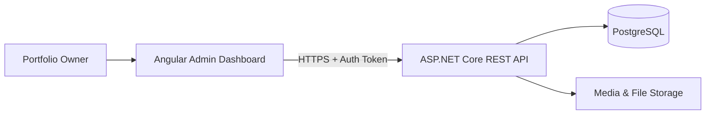

# Admin Frontend Software Architecture

**Application:** Private Portfolio Admin Dashboard (`jobayer-portfolio-admin`)  
**Framework:** Angular (Client-Side Rendered SPA)  
**Backend:** ASP.NET Core REST API (`jobayer-portfolio-api`)  
**Status:** Proposed architecture

## 1. Architectural Goals
- Enforce strict authentication and session lifecycle boundaries.
- Provide predictable, reusable CRUD form and table patterns across all portfolio modules.
- Prevent data loss from accidental navigation or unconfirmed destructive actions.
- Keep HTTP communication and DTO mapping isolated in feature data-access services.

## 2. System Context



## 3. Repository Structure

```text
jobayer-portfolio-admin/
├── AGENTS.md
├── README.md
├── ADMIN_PRD.md
├── docs/
│   ├── ACCESSIBILITY.md
│   ├── API_INTEGRATION.md
│   ├── AUTH_AND_SECURITY.md
│   ├── COMPONENT_CATALOG.md
│   ├── CONTENT_WORKFLOWS.md
│   ├── DECISIONS.md
│   ├── DEPLOYMENT.md
│   ├── DESIGN_SYSTEM.md
│   ├── ENVIRONMENT_AND_CONFIGURATION.md
│   ├── OPEN_QUESTIONS.md
│   ├── ROUTES_AND_NAVIGATION.md
│   ├── SOFTWARE_ARCHITECTURE.md
│   ├── TECH_STACK.md
│   └── TESTING_QA.md
├── public/
│   ├── favicon.ico
│   └── robots.txt
├── src/
│   ├── app/
│   │   ├── core/
│   │   │   ├── auth/
│   │   │   │   ├── auth.service.ts
│   │   │   │   ├── auth.guard.ts
│   │   │   │   └── auth.interceptor.ts
│   │   │   ├── config/
│   │   │   ├── guards/
│   │   │   │   └── unsaved-changes.guard.ts
│   │   │   ├── http/
│   │   │   │   └── error.interceptor.ts
│   │   │   └── services/
│   │   │       └── toast.service.ts
│   │   ├── layout/
│   │   │   ├── admin-shell/
│   │   │   ├── admin-sidebar/
│   │   │   └── admin-header/
│   │   ├── shared/
│   │   │   ├── components/
│   │   │   │   ├── confirm-dialog/
│   │   │   │   ├── data-table/
│   │   │   │   ├── form-field/
│   │   │   │   ├── markdown-editor/
│   │   │   │   ├── media-picker/
│   │   │   │   ├── slug-input/
│   │   │   │   └── status-badge/
│   │   │   └── utils/
│   │   │       └── form-error-mapper.ts
│   │   ├── features/
│   │   │   ├── auth/
│   │   │   ├── dashboard/
│   │   │   ├── profile/
│   │   │   ├── experiences/
│   │   │   ├── projects/
│   │   │   ├── skills/
│   │   │   ├── educations/
│   │   │   ├── publications/
│   │   │   ├── certifications/
│   │   │   ├── blog/
│   │   │   ├── messages/
│   │   │   ├── media/
│   │   │   └── settings/
│   │   ├── app.config.ts
│   │   └── app.routes.ts
│   ├── styles/
│   ├── index.html
│   └── main.ts
├── angular.json
├── package.json
└── tsconfig.json
```

## 4. State & Form Architecture
- **Auth State:** Managed via an Angular Signal-backed `AuthService` tracking current user profile, authentication status, and initialization state.
- **Forms:** Typed Angular `ReactiveFormsModule` (`FormGroup<...>`) with helper methods to populate from API DTOs, track `dirty` status, and map server `ValidationProblemDetails` onto controls.
- **List Views:** Local component signals for filter parameters, pagination state, loading indicators, and active data rows.
